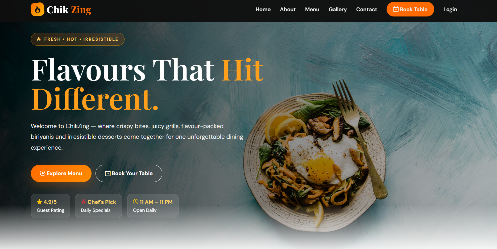

# 🍽️ Restaurant Table Booking Website

## 📌 Project Overview

CHIKZING is a Restaurant Table Booking Website designed to provide users with a simple and convenient way to explore a restaurant and book tables online.

The project focuses on creating an attractive and user-friendly restaurant website with a clean interface and easy navigation.

## ✨ Features

- Attractive restaurant website interface
- User-friendly navigation
- Restaurant information and presentation
- Table booking interface
- Responsive and visually appealing design
- Easy-to-use layout

## 🛠️ Technologies Used

- **HTML5** – Website structure
- **CSS3** – Styling and layout
- **Bootstrap** – Responsive design and UI components
- **JavaScript** – Interactive functionality

## 📂 Project Structure

```text
Restaurant-Table-Booking/
│
├── CHIKZING.html
├── README.md
└── screenshots/
    └── homepage.png
```

## 🚀 How to Run the Project

1. Clone this repository:

   ```bash
   git clone https://github.com/Aminafaiza/Restaurant-Table-Booking.git
   ```

2. Open the downloaded project folder.

3. Locate the `CHIKZING.html` file.

4. Double-click the HTML file or open it using your preferred web browser.

5. Explore the Restaurant Table Booking Website.

## 📸 Screenshots

### Homepage



> Add your actual website screenshot inside the `screenshots` folder and name it `homepage.png`.

## 👩‍💻 Developer

**Amina Faiza HS**

- GitHub: [Aminafaiza](https://github.com/Aminafaiza)

## 🔗 GitHub Repository

[Restaurant Table Booking Website](https://github.com/Aminafaiza/Restaurant-Table-Booking)

---

⭐ If you like this project, feel free to explore the repository!